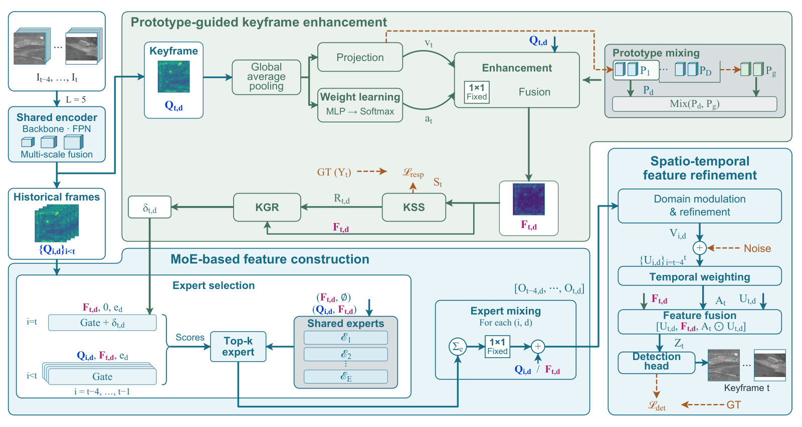
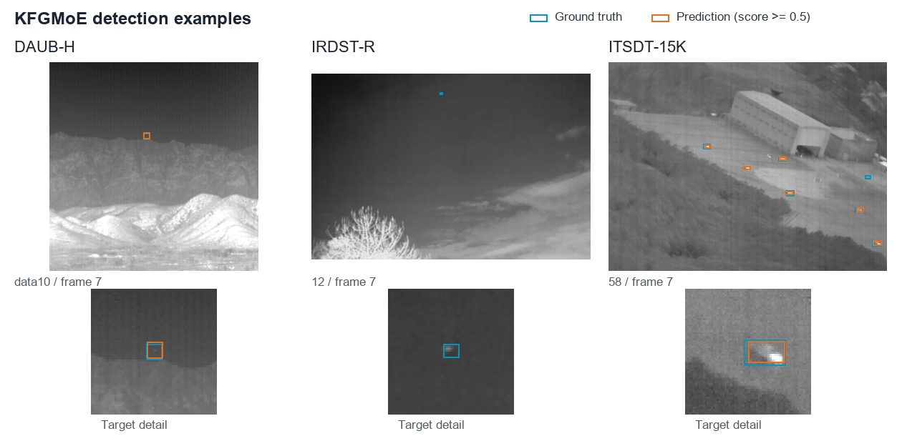

# KFGMoE

**Keyframe-Guided Mixture of Experts for Multi-Domain Moving Infrared Small Target Detection**

Jinwu Lyu, Wenhao Li and Luping Ji

PyTorch implementation of KFGMoE.



## Introduction

KFGMoE uses the current keyframe to guide expert selection and historical feature construction for multi-domain moving infrared small target detection. It combines **prototype-guided keyframe enhancement**, **MoE-based feature construction** and **spatio-temporal feature refinement** in one jointly trained model. Spatial supervision connects detection-relevant keyframe regions to expert allocation, and temporal fusion combines the resulting features for current-frame detection.

## Prerequisite

- Python 3.10
- PyTorch 2.9 and torchvision 0.24

Install PyTorch and torchvision for your CUDA environment, then install the remaining dependencies:

```bash
python -m pip install -r requirements.txt
python tools/prepare_upstream.py
```

The second command prepares the CoMoE dependency; see [THIRD_PARTY.md](THIRD_PARTY.md).

## Datasets

Download the bounding-box versions of **DAUB-H**, **IRDST-R** and **ITSDT-15K** from the [CoMoE benchmark](https://github.com/UESTC-nnLab/CoMoE#datasets-bounding-box-based).

Annotation lists use JSON Lines, with one keyframe per line:

```json
{"path":"DAUB-H/train/data1/12.bmp","domain":1,"boxes":[[100,80,106,86,0]]}
{"path":"DAUB-H/train/data1/13.bmp","domain":1,"boxes":[]}
```

`path` is relative to `--data-root`; boxes use `[x1, y1, x2, y2, 0]` in original-image pixels, or `[]` for an empty frame.

| Dataset | Domain ID |
|---|---:|
| DAUB-H | 1 |
| IRDST-R | 2 |
| ITSDT-15K | 3 |

Each video must contain consecutive BMP frames starting at `0.bmp`, with indices matching the annotations. For one-based originals such as `001.bmp`, prepare a separate zero-based copy aligned with the benchmark labels.

Convert an existing CoMoE-style annotation file (`image_path x1,y1,x2,y2,0 ...`) with:

```bash
python tools/prepare_annotations.py --input original_train.txt --output annotations/train.jsonl --data-root /path/to/datasets
```

Repeat for `test.jsonl`. Use `--strip-prefix /old/dataset/root` for old absolute paths and `--domain` to specify a domain ID when it cannot be inferred from the path.

## Usage

### Train

Save the [CoMoE initialization weights](https://github.com/UESTC-nnLab/CoMoE/blob/bef403e0ee2db33f98675dee080eccc68986ccc8/model_data/pretrain.pth) as `weights/pretrained.pth`:

```bash
python train.py --config configs/kfgmoe.json --train-list annotations/train.jsonl --data-root /path/to/datasets --initial-weights weights/pretrained.pth --output outputs/kfgmoe
```

Settings are in [configs/kfgmoe.json](configs/kfgmoe.json). To resume, replace `--initial-weights weights/pretrained.pth` with `--resume outputs/kfgmoe/latest.pt`.

### Test

Save the [trained KFGMoE weights](https://github.com/UESTC-nnLab/KFGMoE/releases/download/v1.0.0/kfgmoe_epoch060_ema.pth) as `weights/kfgmoe_epoch060_ema.pth`:

```bash
python test.py --config configs/kfgmoe.json --weights weights/kfgmoe_epoch060_ema.pth --annotations annotations/test.jsonl --data-root /path/to/datasets --output runs/test --device cuda
```

### Visualization

Predict a video sequence:

```bash
python predict.py --weights weights/kfgmoe_epoch060_ema.pth --sequence /path/to/video/frames --domain DAUB-H --output runs/demo --device cuda
```



DAUB-H example from Fig. 6(a) of our manuscript. Green boxes indicate ground truth or correct detections, dashed blue boxes mark missed targets and yellow markers identify regions enlarged by ×3.

## Results

Joint training on three domains:

| Dataset | mAP50 (%) | Pr (%) | Rc (%) | F1 (%) | mAP75 (%) | mAP50:95 (%) | Fa ↓ |
|---|---:|---:|---:|---:|---:|---:|---:|
| DAUB-H | 53.7530 | 70.4940 | 77.6877 | 73.9162 | 38.6289 | 33.8694 | 0.151322 |
| IRDST-R | 74.2099 | 83.2310 | 90.6922 | 86.8015 | 0.0126 | 14.4536 | 0.064314 |
| ITSDT-15K | 84.0296 | 90.2328 | 94.1169 | 92.1339 | 11.6903 | 31.3551 | 0.301000 |
| **Macro average** | **70.6642** | **81.3193** | **87.4989** | **84.2839** | **16.7773** | **26.5594** | **0.172212** |

At IoU 0.5, Rc is maximum recall, Pr is mean interpolated precision over that recall range and F1 is their harmonic mean. Fa is false detections per frame at confidence 0.5 and matching IoU 0.5. Macro averages weight the three domains equally.

## Acknowledgements

Our implementation builds on [CoMoE](https://github.com/UESTC-nnLab/CoMoE). We thank its authors and the dataset providers. See [THIRD_PARTY.md](THIRD_PARTY.md) for attribution.

## Contact

Jinwu Lyu: [jinwulyu@outlook.com](mailto:jinwulyu@outlook.com).
